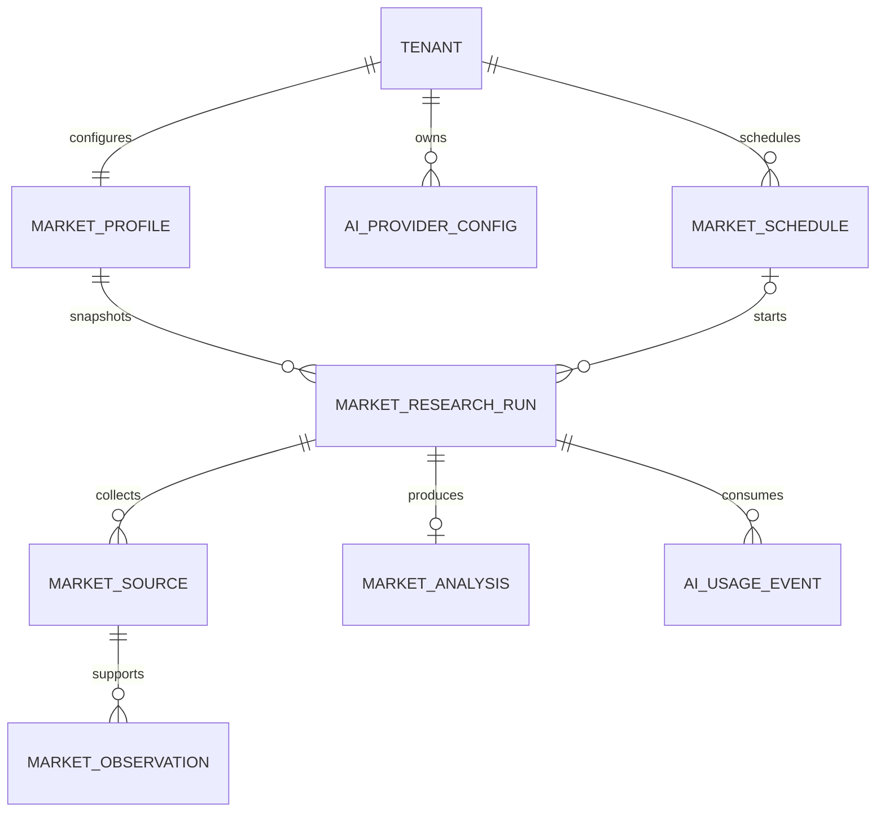

# Thiết kế phân hệ Phân tích thị trường bằng AI

Trạng thái: **ĐÃ TRIỂN KHAI MVP – CHƯA NGHIỆM THU GIAI ĐOẠN 2**. MVP chạy nghiên cứu theo yêu cầu bằng Google Gemini với Google Search grounding khi máy chủ đã có khóa; các yêu cầu kiểm thử provider thật, usage/quota, lịch tự động và các tiêu chí đầy đủ bên dưới vẫn còn.

## 1. Hiện trạng và mục tiêu

`/market-intelligence` là module riêng dành cho owner/admin, có đường dẫn trong menu quản trị và menu phân hệ. Trang cho phép nhập ngành, thị trường và câu hỏi; Gemini tự tìm kiếm thông tin web công khai, tổng hợp và lưu lịch sử theo tenant. Giao diện chỉ trả về một bản phân tích ngắn, không liệt kê bài viết. Nguồn grounding được giữ nội bộ trong dữ liệu lần chạy; độ bao phủ phụ thuộc kết quả tìm kiếm của Google.

`src/components/AIConversationSummary.tsx` hiện là gợi ý theo quy tắc trong Demo và thông báo chưa kết nối ở Live. Không dùng thành phần này như bằng chứng đã có AI/search thật.

Mục tiêu là nghiên cứu theo cấu hình của tenant, không phụ thuộc một ngành hàng hay một nhà cung cấp AI. Smart home chỉ là industry template đầu tiên. Tenant mỹ phẩm, nội thất hoặc ngành khác có bộ ngữ cảnh, nguồn và lịch nghiên cứu riêng.

## 2. Ranh giới module và cấu hình

- Core cung cấp xác thực, tenant context, quyền, kho bí mật, audit, job queue và usage ledger.
- Business Configuration lưu hồ sơ doanh nghiệp, mô hình B2B/B2C/phân phối/dịch vụ, ngành nghề, danh mục, khách hàng mục tiêu, địa lý, phân khúc giá, đối thủ, từ khóa và ngôn ngữ.
- Industry Template cung cấp bộ câu hỏi, nhóm sản phẩm và thuộc tính gợi ý có phiên bản. Áp dụng template tạo cấu hình riêng; sửa template không âm thầm đổi doanh nghiệp đã sử dụng.
- Market module sở hữu nghiên cứu, nguồn chứng cứ, quan sát giá, kết quả phân tích, lịch và usage. Chỉ đọc catalog đã được cấp quyền; không tự chỉnh giá hoặc tồn kho.

Các port phía server:

```ts
interface SearchProvider {
  search(input: SearchRequest, context: TenantJobContext): Promise<SearchResult[]>
}
interface AiProvider {
  analyze(input: GroundedAnalysisRequest, context: TenantJobContext): Promise<AnalysisResult>
}
```

Request gồm ngân sách, timeout, locale và cấu hình model đã được server resolve. Không cho model chọn tenant, API key hay tự gọi mọi URL. Provider registry định nghĩa adapter và khả năng hỗ trợ; tên model là cấu hình được kiểm tra với adapter. Prompt template có version, input schema, output schema và quyền xuất bản. Cấu hình provider gồm tham chiếu bí mật đã mã hóa, không chứa khóa trong dữ liệu trả frontend hoặc biến `VITE_*`.

## 3. Chức năng và dữ liệu đích

Dashboard, hồ sơ ngành hàng, sản phẩm cần nghiên cứu, đối thủ, truy vấn tự do, báo cáo AI có cấu trúc, nguồn dữ liệu, quan sát giá, lịch sử và lịch tự động. Các nhóm phân tích: tổng quan, đối thủ, giá, xu hướng sản phẩm, khách hàng mục tiêu và đề xuất chiến lược. Chỉ hiển thị biểu đồ khi có đủ điểm dữ liệu có thể so sánh.

Mọi bảng nghiệp vụ có `tenant_id`, thời điểm UTC và khóa ghép bảo đảm tham chiếu cùng tenant. Các tên dưới đây là schema logic, cần migration khi triển khai; xem [thiết kế tổng thể](DATABASE_DESIGN.md).

| Bảng logic                | Trường chính và ràng buộc                                                                                                                                             |
| ------------------------- | --------------------------------------------------------------------------------------------------------------------------------------------------------------------- |
| `market_profiles`         | tenant PK, company_name, industry, business_model, target_customers, regions, price_segments, version; tập danh mục/từ khóa có cấu trúc, không một chuỗi prompt tùy ý |
| `market_competitors`      | id, tenant, name, public_url, active; URL HTTP(S) đã chuẩn hóa                                                                                                        |
| `market_watch_items`      | id, tenant, product/SKU reference tùy chọn, query_terms, competitor_ids; tham chiếu sản phẩm cùng tenant                                                              |
| `ai_provider_configs`     | id, tenant, adapter_key, model, secret_ref, enabled, token/request/spend limits, version; không lưu secret dạng rõ                                                    |
| `search_provider_configs` | id, tenant, adapter_key, secret_ref, allowed_domains, request limits, version                                                                                         |
| `prompt_templates`        | id, tenant, kind, version, content, output_schema_version, published_at; phiên bản đã dùng không sửa tại chỗ                                                          |
| `market_research_runs`    | id, tenant, question, status, context_snapshot, config versions, requested_by, idempotency_key, queued/started/finished_at, error_code                                |
| `market_sources`          | id, tenant, run, canonical_url, title, publisher, published_at nullable, fetched_at, content_hash, evidence_excerpt, retrieval_status, confidence_basis               |
| `market_observations`     | id, tenant, run, source, observed_at, product_match, metric, numeric_value nullable, currency/unit, tax/shipping/promotion context, verification_status               |
| `market_analyses`         | id, tenant, run, schema_version, sections JSON, assumptions, limitations, model/prompt versions, created_at; assertions chứa source IDs hoặc nhãn giả định            |
| `market_schedules`        | id, tenant, profile/watch scope, timezone IANA, schedule, next_run_at, enabled, last_run_at                                                                           |
| `ai_usage_events`         | id, tenant, run, provider_request_id, operation, input/output tokens nullable, search calls, estimated/actual cost, currency, status                                  |

Index đề xuất: `(tenant_id, created_at DESC, id)`, runs theo `(tenant_id,status,queued_at)`, sources unique `(tenant_id,run_id,canonical_url,content_hash)`, observations `(tenant_id,metric,observed_at)`, schedules `(enabled,next_run_at)`. Chỉ worker nội bộ được quét lịch xuyên tenant. Usage chống trùng theo tenant + provider_request_id + operation; provider không có request ID dùng ID lần gọi do server tạo.



## 4. API specification dự kiến

Tiền tố `/api/v1/market-intelligence`. Tenant được resolve từ phiên đăng nhập và membership đã kiểm chứng. API không tin `tenant_id` trong body hoặc truy vấn. Pagination bằng cursor, giới hạn page size và trả `requestId` cùng lỗi có mã ổn định.

MVP hiện có `GET /status`, `GET /runs` (20 lần gần nhất) và `POST /research` (chạy đồng bộ, `Idempotency-Key` bắt buộc). Các endpoint cấu hình profile/provider, prompt, observation, cancel, usage và schedule trong bảng dưới vẫn là thiết kế đích; chưa được triển khai.

| Method/path                       | Quyền                          | Hành vi                                                                                |
| --------------------------------- | ------------------------------ | -------------------------------------------------------------------------------------- |
| GET/PUT `/profile`                | market.read / market.configure | Đọc/sửa ngữ cảnh có `If-Match` version                                                 |
| GET/POST `/competitors`           | market.read / market.configure | Liệt kê/tạo đối thủ; PATCH `/:id` để sửa                                               |
| GET/POST `/watch-items`           | market.read / market.configure | Cấu hình sản phẩm, nhóm và từ khóa                                                     |
| GET/PUT `/providers/:kind`        | market.configure               | Metadata, trạng thái; PUT nhận secret qua TLS, GET chỉ trả masked/reference            |
| GET/POST `/prompt-templates`      | market.configure               | Quản lý phiên bản; publish là action riêng có audit                                    |
| POST `/research`                  | market.run                     | `{question, watchItemIds, period, analysisKinds}`; `Idempotency-Key`; trả 202 + run ID |
| GET `/research/:id`               | market.read                    | Trạng thái, lỗi, metadata, kết quả khi hoàn thành                                      |
| POST `/research/:id/cancel`       | market.run                     | Yêu cầu hủy; không hứa hoàn tác chi phí provider đã phát sinh                          |
| GET `/research/:id/sources`       | market.read                    | Chứng cứ, thời điểm, nguồn, độ tin cậy và hạn chế                                      |
| GET `/observations`               | market.read                    | Filter sản phẩm/đối thủ/chỉ số/kỳ; trả nguồn kèm từng quan sát                         |
| GET/POST/PATCH `/schedules[/:id]` | market.schedule                | Lịch có timezone, bật/tắt và quota                                                     |
| GET `/usage`                      | market.usage.read              | Tổng usage thực tế/ước tính theo kỳ và giới hạn                                        |

Lỗi: 400 dữ liệu sai; 401 chưa đăng nhập; 403 thiếu quyền/module tắt; 404 ID không thuộc tenant hoặc không tồn tại; 409 version/idempotency conflict; 422 cấu hình/nguồn không phù hợp; 429 vượt quota; 502/503 provider lỗi. Không trả secret hoặc toàn bộ provider error nhạy cảm.

## 5. Luồng nghiệp vụ và chất lượng chứng cứ

1. Kiểm tra module, quyền, ngữ cảnh hợp lệ, provider được bật và quota. Chụp phiên bản cấu hình/prompt/product metadata cùng câu hỏi vào run. Idempotency key + hash payload được lưu cùng job trong transaction.
2. Worker nhận job cùng tenant context đã được kiểm tra lại. Search dựng truy vấn từ hồ sơ và câu hỏi; tất cả kết quả gắn run/tenant. Cache, vector index, object storage, log và job lock phải có namespace tenant.
3. Chỉ lấy trang công khai hoặc nguồn có quyền truy cập. Giới hạn kích thước, số trang, redirects và thời gian; chặn localhost/private/link-local IP, kiểm tra lại DNS/redirect để tránh SSRF. Tuân theo chính sách truy cập nguồn và không vượt cơ chế bảo vệ.
4. Nội dung web là dữ liệu không tin cậy: chỉ trích xuất bằng schema, không dùng chỉ dẫn trong trang làm system prompt, không cấp tool tùy ý cho model. Không gửi hồ sơ khách hàng/bí mật công ty cho provider tìm kiếm.
5. Chuẩn hóa giá theo tiền tệ, đơn vị, biến thể, thời điểm, thuế, giao hàng và khuyến mãi. Không gộp model gần tên thành một sản phẩm đã xác nhận. Thiếu dữ liệu là `null`/“Chưa xác minh”, không phải 0.
6. AI chỉ phân tích evidence set thuộc run. Mỗi nhận định có danh sách nguồn hợp lệ, hoặc `kind: assumption`/`inference` và cơ sở. Server validate cấu trúc, reference IDs và mọi con số trích từ quan sát; nguồn không đủ thì báo thiếu dữ liệu. Không trình bày suy luận của AI như số liệu thị trường đã kiểm chứng.
7. Lưu kết quả, usage và trạng thái; audit chỉ ghi metadata an toàn. Worker retry giới hạn, dùng khóa job và checkpoint; gọi provider ngoài transaction DB. Không giữ transaction dài suốt quá trình mạng.

Độ tin cậy gồm xuất xứ, thời gian, chất lượng nguồn, khả năng đối chiếu và phạm vi kiểm chứng. Đây là đánh giá chất lượng bằng chứng; không phải xác suất “AI đúng”. Thời điểm thu thập khác thời điểm giá có hiệu lực; thiếu ngày công bố phải để trống. Hai nguồn sao chép cùng một thông cáo không được tính thành hai chứng cứ độc lập.

Lịch chạy dùng khóa unique `(tenant_id,schedule_id,scheduled_for)` để không tạo job trùng; quota được giữ ngân sách trước chạy, quyết toán sau chạy, có hạn mức cạnh tranh giữa các worker. Với nguồn thiếu dữ liệu theo kỳ, không dựng đường xu hướng giả.

## 6. Test cases và acceptance criteria

| Ca kiểm thử                               | Điều kiện đạt                                                                                    |
| ----------------------------------------- | ------------------------------------------------------------------------------------------------ |
| Tenant A smart home và tenant B mỹ phẩm   | Query, prompt, nguồn, lịch, cache và kết quả dùng đúng cấu hình; không chứa thông tin tenant kia |
| Đổi AI/search adapter                     | Thay cấu hình không đổi UI/domain; adapter không hỗ trợ capability trả lỗi rõ                    |
| Thiếu key/model/search                    | Chặn chạy và hướng dẫn cấu hình; không tạo kết quả Demo trong Live                               |
| Search timeout/empty/partial              | Lưu trạng thái và hạn chế; không sinh số thị trường tưởng tượng                                  |
| Model trả nguồn ngoài evidence set        | Validation từ chối; không publish báo cáo như đã xác minh                                        |
| Giá khác biến thể/tiền tệ/khuyến mãi      | Không so sánh trực tiếp khi thiếu chuẩn hóa                                                      |
| Duplicate request/job và quota cạnh tranh | Tối đa một run theo key; không vượt hạn mức do race condition                                    |
| Prompt injection/URL nội bộ/redirect      | Không thực thi chỉ dẫn web và không truy cập mạng nội bộ                                         |
| Người chỉ có market.read                  | Không xem secret, sửa cấu hình hoặc tạo job                                                      |
| Đổi ngữ cảnh trong khi job chạy           | Run giữ snapshot cũ và hiển thị rõ phiên bản                                                     |
| Hai lịch trùng giờ hoặc DST               | Mỗi occurrence chạy tối đa một lần; timezone có thể kiểm tra                                     |

Nghiệm thu khi các ca trên có unit/integration test, thử thật một provider và search có quyền, kiểm tra UI desktop/narrow/keyboard, báo cáo smart home có nguồn kiểm chứng, và thử tenant ngành khác chỉ đổi cấu hình. Cần audit, usage, hủy/retry và xử lý provider lỗi hoạt động trước khi gọi tính năng “AI đã tích hợp”.

## 7. Kết quả hiện tại và phần chưa hoàn thành

MVP có migration lưu run/grounding metadata/kết quả tenant-scoped, endpoint có kiểm tra admin, Gemini Google Search grounding, giao diện đặt câu hỏi/lịch sử/bản phân tích tóm tắt và khóa idempotency. Cấu hình cục bộ dùng `GEMINI_API_KEY` và tùy chọn `GEMINI_MODEL`; chạy `npm run server:inventory` để nạp `.env`. Khóa chỉ được đọc ở Node API, không dùng `VITE_*` và không trả về trình duyệt.

Mỗi lượt gửi chủ đề/câu hỏi tới Gemini; Google Search grounding hỗ trợ tìm kiếm thông tin công khai. Không gửi hồ sơ khách hàng. Giao diện chỉ hiển thị bản phân tích tóm tắt; nguồn grounding không được trả thành danh sách bài viết cho trình duyệt. Đây không phải dữ liệu thị trường đã kiểm toán; cần xác minh kết luận trước khi ra quyết định.

Chưa có cấu hình provider theo từng tenant trong UI, thu thập/trích xuất toàn trang, kiểm chứng chéo tính độc lập nguồn, xác minh ngữ nghĩa mọi con số, usage/cost ledger, ngân sách/quota, worker, hủy/retry quản trị, lịch tự động, prompt management hoặc thử nghiệm provider thật trong môi trường triển khai. Không coi MVP là hoàn tất toàn bộ Giai đoạn 2; cần cấu hình khóa hợp lệ và nghiệm thu các ca trong mục 6.
