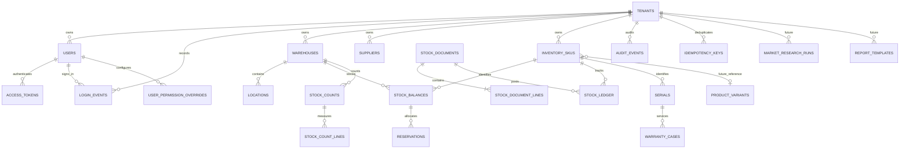

# Thiết kế dữ liệu thống nhất

## Dữ liệu hiện có và migration

OperationsData v1 trong localStorage là dữ liệu legacy, không phải database doanh nghiệp. Backend kho hiện dùng SQLite tại `var/inventory.sqlite`; giữ nguyên dữ liệu localStorage, không import tự động hoặc sửa stock cũ. `server/migrations` là lịch sử schema backend, áp dụng có transaction và bảng schema_migrations. Sao lưu database trước nâng cấp; rollback triển khai bằng bản backup đã kiểm tra, không xóa ledger.

## Quy ước

ID UUID/text opaque; tất cả thực thể nghiệp vụ có tenant_id. Unique và foreign key ghép `(tenant_id,id)` ngăn tham chiếu chéo tenant. Số lượng và VND dùng integer an toàn, không dùng float cho giá trị ghi sổ. Thời gian ISO UTC. Không ghi secret/token nguyên văn vào audit. Index đầu tenant_id rồi chiều lọc/ngày, unique SKU/mã kho/mã chứng từ/serial theo tenant.

## ERD tổng thể và kho

Schema thực thi Giai đoạn 1 được xác định chính xác trong migration SQL; ERD bao gồm quan hệ đích chưa thực thi. `inventory_skus` là danh tính hàng hóa tối thiểu, không thay thế module sản phẩm tương lai. Không có endpoint chỉnh balance trực tiếp. Opening stock cũng qua receipt, không có seed tồn ẩn.

Migration thực thi: `001_inventory.sql` tạo core/kho, `002_inventory_quality.sql` thêm buckets lỗi/bảo hành, quality journal và cost kiểm kê; `003_inventory_returns.sql` tạo `serial_issues` và `stock_document_returns` để kiểm nguồn/giá trị hàng trả; `007_accounts.sql` bổ sung thông tin đăng nhập; `008_auth_activity.sql` lưu lịch sử đăng nhập; `009_permission_overrides.sql` lưu quyền tùy chỉnh theo người dùng trên nền role presets hiện có. Chuẩn hóa roles/permissions/user_roles và phân quyền theo kho vẫn là phần kế tiếp. Schema migration checksum bị thay đổi sẽ làm startup fail, không âm thầm bỏ qua. Idempotency lưu request hash + kết quả entity, replay trả snapshot hiện tại để không làm lùi màn hình.

## Nhất quán và đồng thời

Mỗi command mở `BEGIN IMMEDIATE`: xác thực quyền/chính sách → lấy idempotency key + hash payload → validate trạng thái/version → kiểm tồn khả dụng → cập nhật chứng từ/balance/serial/ledger/audit/result → commit. Lỗi rollback toàn bộ. WAL và busy_timeout điều phối writer giữa connection/process trên cùng database; không bảo đảm scale-out trên network filesystem. Cùng key + cùng payload trả lại kết quả cũ; khác payload trả 409. Tồn, ledger, trạng thái và audit phải commit cùng nhau.

Giữ chỗ, hàng lỗi/bảo hành không được tính hai lần. `available = onHand - reserved - damaged - warranty`. Chuyển hàng rời kho nguồn đi vào transit; kho đích nhận bằng nghiệp vụ riêng. Pending receipt không phải onHand. Chứng từ đã ghi sổ không sửa/xóa; sửa sai qua chứng từ bù có tham chiếu.

## Thiết kế các giai đoạn sau

Catalog: categories (self-parent tenant), products, variants, attribute_definitions/sets/values có kiểu, product_sources, lifecycle_history. Market: tenant_business_profiles, provider_configs (secret reference), prompt_versions, research_jobs/runs, sources/observations, claims/citations, usage. Reporting: report_templates, dashboard_widgets, shares, export_jobs. Xem ERD từng module trong tài liệu tương ứng; chưa tạo các bảng tương lai cho đến giai đoạn được nghiệm thu.

## Production gate

Backup/restore định kỳ và diễn tập; quản trị token/SSO, TLS reverse proxy, rotation, rate limit, retention, monitoring, load test theo quy mô triển khai. PostgreSQL migration cần chạy lại concurrency/tenant tests; không chỉ đổi driver rồi coi tương đương.
