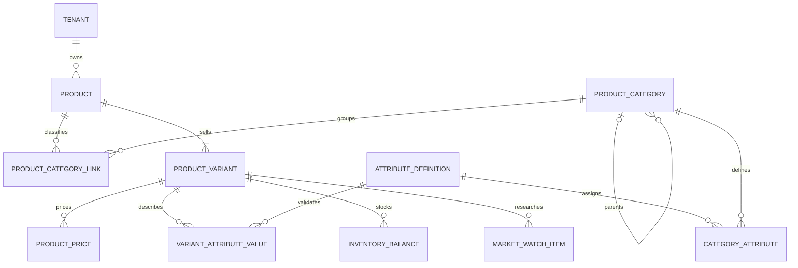

# Thiết kế phân hệ Quản lý sản phẩm

Trạng thái: **ĐÃ CÓ DANH MỤC SKU CƠ BẢN; CATALOG GIAI ĐOẠN 3 CHƯA TRIỂN KHAI**. Trang `/products` đọc và chỉnh sửa SKU qua API kho, gồm nhóm hàng, giá bán, mô tả, ảnh và thông số. Các bảng/API dưới đây là hợp đồng đích cho catalog độc lập, không phải chức năng đã có.

## 1. Hiện trạng, tái sử dụng và mục tiêu

`src/modules/operations/types.ts` có Product phẳng: `id`, `sku`, `name`, `price`, `stock`, metadata tùy chọn. Product được dùng bởi đơn hàng, danh mục báo giá và PDF; `OrderLine` giữ snapshot tên/SKU/giá để bảo toàn lịch sử. Bộ demo hiện tại trong `src/modules/operations/data.ts` là sáu sản phẩm gốm/trang trí. Mục Products trong sidebar chưa có CRUD catalog độc lập.

Giữ ID và hợp đồng tương thích cho đơn hàng/báo giá khi di chuyển. Tồn kho thuộc Inventory, không thuộc CRUD Product. Trang `/products` là giao diện danh mục SKU hiện có, không tạo API hoặc nguồn tồn riêng; tồn khả dụng đọc từ số dư kho. `stock` cũ là projection tương thích trong giai đoạn chuyển đổi; không cho PATCH số tồn và không tạo hai nguồn tồn kho độc lập.

Mục tiêu là catalog nhiều tenant, ngành bất kỳ, có danh mục phân cấp, biến thể/SKU, thuộc tính có kiểu, lifecycle, lịch sử thay đổi và nguồn thông tin có thể kiểm tra. Không tạo cột cố định riêng cho điện áp, Zigbee hoặc dung tích.

## 2. Chức năng và cấu hình

- Danh mục cha/con, bộ thuộc tính theo danh mục, thương hiệu, nhà cung cấp và đơn vị tính riêng tenant.
- Product cha chứa thông tin chung; mỗi sellable variant có SKU, barcode, giá, tổ hợp thuộc tính và tracking policy riêng. Product đơn giản vẫn có một default variant.
- Tên, mã nội bộ, mô tả, hình, giá nhập/niêm yết/bán theo tiền tệ, nguồn kỹ thuật và trạng thái. Giá chưa biết để `null`, không dùng 0 như dữ liệu thay thế.
- Lifecycle `new → active → paused → discontinued`; các bước quay lại chỉ qua transition hợp lệ và quyền. Sản phẩm liên quan/thay thế có kiểu quan hệ, không tự ánh xạ thành cùng SKU.
- Admin tạo attribute definition, kiểu, nhóm, giá trị cho phép, đơn vị, required/searchable/filterable và category assignment. Template ngành chỉ khởi tạo cấu hình, không làm domain phụ thuộc ngành.
- Tùy chọn quản lý serial/IMEI/lot/batch được Inventory sử dụng trên variant. Catalog định nghĩa chính sách; Inventory giữ từng định danh và lịch sử chuyển trạng thái.

## 3. Schema logic, index và ERD

Tất cả khóa ngoại nghiệp vụ phải kiểm chứng cùng `tenant_id`. Thiết kế tổng thể và migration core xem [DATABASE_DESIGN.md](DATABASE_DESIGN.md). Không tự chạy migration catalog tương lai trong Giai đoạn 1.

| Bảng logic                 | Trường chính / ràng buộc                                                                                                                                                |
| -------------------------- | ----------------------------------------------------------------------------------------------------------------------------------------------------------------------- |
| `product_categories`       | id, tenant, parent_id nullable, code, name, active, version; unique tenant+code, cấm chu kỳ cha/con                                                                     |
| `brands`                   | id, tenant, code, name                                                                                                                                                  |
| `products`                 | id, tenant, code, name, description, brand_id, lifecycle, unit_id, version, created/updated_at; unique tenant+code                                                      |
| `product_category_links`   | tenant, product_id, category_id, is_primary; một danh mục primary nếu sản phẩm đã active                                                                                |
| `product_variants`         | id, tenant, product_id, sku, barcode nullable, model nullable, status, identifier_policy, variant_signature, version; unique tenant+normalized SKU và product+signature |
| `product_prices`           | id, tenant, variant, price_type, amount nullable, currency, valid_from/to, source_id nullable; không âm, không chồng kỳ cùng loại giá                                   |
| `product_suppliers`        | tenant, variant, supplier, supplier_product_code nullable, lead_time_days nullable; dùng Supplier chung với kho                                                         |
| `attribute_definitions`    | id, tenant, code, label, type, unit nullable, required_default, searchable, filterable, validation_schema, version                                                      |
| `attribute_options`        | id, tenant, definition, code, label, active; unique definition+code                                                                                                     |
| `attribute_groups`         | id, tenant, code, label, ordering                                                                                                                                       |
| `category_attributes`      | tenant, category, definition, group nullable, required, variant_axis, ordering                                                                                          |
| `product_attribute_values` | tenant, product, definition, type, typed value columns; unique product+definition                                                                                       |
| `variant_attribute_values` | tenant, variant, definition, type, typed value columns; unique variant+definition                                                                                       |
| `product_media`            | id, tenant, product/variant, safe URL/object ref, alt_text, ordering, source_id nullable, rights_note                                                                   |
| `product_sources`          | id, tenant, public_url, title, fetched_at, verified_fields, content_hash nullable, verification_status                                                                  |
| `product_relations`        | tenant, product, related_product, relation_type; cấm self link, reference cùng tenant                                                                                   |
| `product_change_events`    | id, tenant, entity/ref, actor, action, version, before/after hoặc safe diff, at; append-only                                                                            |

Kiểu attribute: `text`, `number`, `boolean`, `date`, `enum`, `multi_enum`. Mỗi value chỉ dùng đúng một cột tương ứng; multi enum qua bảng liên kết option thay vì chuỗi phân cách. Definition có kiểu bất biến sau khi có dữ liệu; thay đổi kiểu cần migration dữ liệu có kiểm tra, không cast âm thầm. `number` có precision, min/max và đơn vị; `date` khác timestamp. Giá là money domain, không một attribute số tùy ý.

Index: `(tenant_id,lifecycle,id)` trên product; `(tenant_id,product_id,status)` trên variant; unique normalized SKU/barcode theo tenant khi barcode không null; `(tenant_id,definition_id,number_value)` và tương tự date/enum cho filter được bật; full-text/trigram hoặc search adapter trên tên/SKU/text đã chuẩn hóa hỗ trợ tiếng Việt. Không lập index mọi JSON key tùy ý. Query có giới hạn số filter và phân trang.

## 4. API specification dự kiến

Tiền tố `/api/v1/catalog`; tenant lấy từ authenticated context. ID tenant khác trả 404. Module tắt hoặc thiếu quyền trả 403. GET phân trang và allowlist sort/filter; PATCH cần `If-Match` version, lỗi stale trả 409. Những thao tác tạo dùng `Idempotency-Key` và hash body.

| Method/path                                    | Quyền                            | Input/behavior                                                                                                 |
| ---------------------------------------------- | -------------------------------- | -------------------------------------------------------------------------------------------------------------- |
| GET/POST `/categories`                         | catalog.read / catalog.manage    | Cây danh mục giới hạn độ sâu; POST `{code,name,parentId}`                                                      |
| PATCH `/categories/:id`                        | catalog.manage                   | Đổi metadata/cha; kiểm tra chu kỳ và sản phẩm đang dùng                                                        |
| GET/POST `/products`                           | catalog.read / catalog.manage    | Tìm tên/SKU, trạng thái, category, brand, typed filters; POST tạo product + variant mặc định trong transaction |
| GET/PATCH `/products/:id`                      | catalog.read / catalog.manage    | Chi tiết và metadata; không nhận stock                                                                         |
| POST `/products/:id/transitions`               | catalog.manage                   | `{status,reason}`; ghi lịch sử                                                                                 |
| GET/POST `/products/:id/variants`              | catalog.read / catalog.manage    | SKU, barcode, option combination; tổ hợp không trùng                                                           |
| PATCH `/variants/:id`                          | catalog.manage                   | Metadata/policy có guard nếu đã có serial/lot hoặc giao dịch                                                   |
| PUT `/variants/:id/prices`                     | catalog.price.manage             | Loại giá, số tiền/đơn vị tiền, thời gian; không sửa giá snapshot đơn cũ                                        |
| GET/POST `/attribute-definitions`              | catalog.read / catalog.configure | Kiểu và validation; definition dùng chung trong tenant                                                         |
| PUT `/categories/:id/attributes`               | catalog.configure                | Định nghĩa required/variant axes; preview impact trước khi publish                                             |
| PUT `/products/:id/attributes`                 | catalog.manage                   | Value map theo definition ID, validate kiểu/option/scope                                                       |
| PUT `/variants/:id/attributes`                 | catalog.manage                   | Value map biến thể; cập nhật signature atomically                                                              |
| GET `/products/:id/history`                    | catalog.audit.read               | Lịch sử có phân trang                                                                                          |
| POST `/imports/preview`, `/imports/:id/commit` | catalog.import                   | Validate toàn bộ, hiển thị lỗi từng dòng, confirm có idempotency                                               |

Ví dụ kiểu filter: `{attributeId, operator: 'eq'|'in'|'gte'|'lte', value}`; operator phải phù hợp type. Không nhận SQL, column hoặc JSONPath tùy ý từ trình duyệt.

## 5. Business logic và tích hợp

Tạo product/variant, kiểm tra unique SKU, giá, giá trị required và audit trong cùng transaction. Active product phải đủ trường bắt buộc theo category configuration version; draft được lưu kèm validation warnings. Thay required/schema không khiến dữ liệu cũ bị mất: preview impact, lưu phiên bản, cho migration có kiểm soát. Quyền sửa giá tách quyền sửa mô tả.

Không xóa cứng sản phẩm/variant đã được chứng từ, serial hoặc đơn hàng tham chiếu. Archive/discontinue giữ lịch sử. Sửa SKU không sửa snapshot đơn hàng cũ; liên kết bằng immutable variant ID. Stock read model lấy từ Inventory, không cộng trừ bằng việc sửa catalog.

Orders phải chụp variant ID, SKU, tên, đơn giá, tiền tệ; yêu cầu giá bán hợp lệ trước xác nhận. Báo giá không biến “chưa có giá” thành miễn phí. Supplier pricing là lịch sử báo giá/nhập theo supplier và khác giá vốn thực tế từ ledger kho.

Tracking policy `none|serial|lot|batch` có thể kết hợp flags phù hợp; serial/IMEI unique trong tenant theo chính sách, không coi một SKU là serial. Bảo hành tham chiếu serial và chứng từ bán đã xác minh. Thay policy khi có tồn cần đợt chuyển đổi định danh và đối soát, không sửa tùy ý.

## 6. Kế hoạch chuyển demo sang hệ sinh thái Lumi

Nguồn mục tiêu do người dùng cung cấp: [website Lumi](https://lumi.vn/). Đã kiểm tra truy cập trang chủ ngày 17/11/2026; chưa nhập hoặc xác nhận theo từng trang chi tiết sản phẩm, model, giá, hình ảnh hay thông số cho catalog. Việc thu thập và xác minh từng trường diễn ra ở Giai đoạn 3; không đưa dữ liệu trang chủ vào seed kho hiện tại.

1. Duyệt trang sản phẩm công khai, lưu URL từng sản phẩm và thời điểm thu thập. Xây danh mục theo nhóm được trang nguồn chứng thực; không suy đoán danh sách model.
2. Ghi từng trường kỹ thuật kèm nguồn xác minh. Trường thiếu hiển thị “Chưa có thông tin”; giá không công khai là null. Không lấy thông số từ sản phẩm tương tự.
3. SKU nội bộ có prefix `DEMO-` và nhãn “Mã demo do hệ thống tạo”; không trình bày như mã chính hãng. Chỉ tạo biến thể khi nguồn xác nhận. Hình cần có nguồn/quyền dùng; thiếu hình dùng placeholder trung tính có nhãn.
4. Số tồn, chứng từ, serial minh họa và giá vốn dùng để thử kho phải có nhãn dữ liệu Demo nội bộ, tách khỏi thông tin kỹ thuật/giá công khai Lumi. Serial demo không dùng như số thiết bị thực.
5. Migration Demo có backup và mapping ID; không ghi đè metadata doanh nghiệp đã tự sửa hoặc đổi tên sản phẩm cũ trong các đơn hàng lịch sử. Có thể tạo catalog demo mới và lưu các sản phẩm cũ ở trạng thái archive, đồng thời giữ reference.
6. Liên kết variant mới với kho qua chứng từ opening/import hợp lệ; market watch item tham chiếu variant; report đọc chung ID. Không tự tạo market insight chưa nghiên cứu.

Live không tự seed catalog Lumi và không rơi về Demo khi API lỗi. Doanh nghiệp khác được chọn template/cấu hình khác mà không fork mã nguồn.

## 7. Test cases và acceptance criteria

| Ca kiểm thử                                          | Điều kiện đạt                                                    |
| ---------------------------------------------------- | ---------------------------------------------------------------- |
| Tenant trùng SKU, tên attribute khác nhau            | Hợp lệ giữa tenant; trùng trong một tenant bị từ chối            |
| Category cycle, reference tenant khác                | Bị chặn ở API/domain/DB                                          |
| Enum sai, số ngoài giới hạn, boolean dạng chuỗi      | Validation từ chối, không lưu một phần                           |
| Required theo category và đổi schema đang có dữ liệu | Active validate đúng, preview không làm mất dữ liệu              |
| Variant trùng tổ hợp, concurrent SKU creation        | Chỉ một bản hợp lệ; conflict có mã rõ                            |
| Stock trong PATCH product                            | Bị từ chối; số tồn chỉ đổi bằng nghiệp vụ Inventory              |
| Sửa tên/giá rồi xem đơn cũ                           | Snapshot lịch sử được giữ                                        |
| Hai người sửa cùng version                           | Một update thành công, một conflict                              |
| Import replay hoặc lỗi giữa chừng                    | Không tạo trùng/không commit một phần ngoài chính sách đã định   |
| Lumi thiếu giá/model/spec                            | Hiển thị unknown có nguồn; không điền số tùy ý                   |
| Chuyển tenant smart home sang mỹ phẩm                | Tạo schema thuộc tính và catalog bằng cấu hình, không sửa domain |

Nghiệm thu cần unit/integration test cho các ca trên; migration rehearsal với dữ liệu Demo cũ; UI desktop/narrow/keyboard; tìm kiếm tiếng Việt; liên kết nhập/xuất kho, đơn hàng, báo giá và báo cáo không đứt reference. Benchmark filter có tenant+typed indexes trên tập dữ liệu quy mô đã thống nhất trước phát hành.

## 8. Kết quả hiện tại và chưa hoàn thành

Đã có CRUD SKU cơ bản trên API kho và giao diện danh mục ở `/products`. Đã hoàn thành thiết kế catalog, dynamic attributes, phiên bản, API và kế hoạch nguồn/migration Demo. Chưa triển khai CRUD product/variant độc lập, migrations Giai đoạn 3, bộ thuộc tính động, import, lịch sử sản phẩm hoặc dữ liệu Lumi. Giao diện SKU hiện tại không đồng nghĩa hoàn tất phân hệ catalog.
