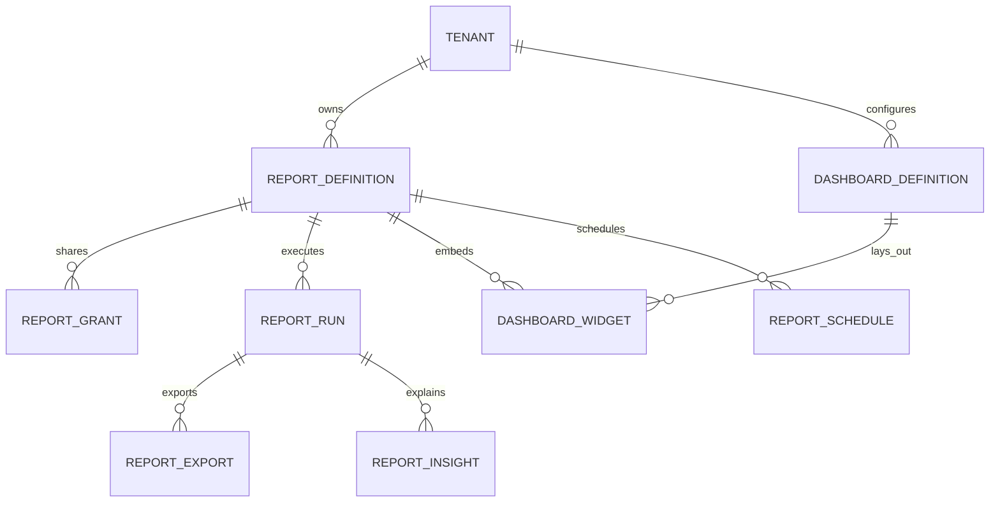

# Thiết kế phân hệ Báo cáo và phân tích

Trạng thái: **THIẾT KẾ – CHƯA TRIỂN KHAI GIAI ĐOẠN 4**. Báo cáo kho tối thiểu của Giai đoạn 1 thuộc Inventory; Custom Report Builder và AI reporting chỉ triển khai sau nghiệm thu giai đoạn trước. Schema/API bên dưới là đề xuất đích.

## 1. Hiện trạng và mục tiêu

Dashboard hiện tại ở `src/modules/dashboard/DashboardPage.tsx` dùng hàm thuần `metrics.ts` để tổng hợp Inbox/Operations snapshots. Có bộ lọc 7/30/90 ngày, biểu đồ xu hướng, trạng thái đơn, sản phẩm được đặt nhiều, công việc và hàng tồn thấp. `docs/dashboard.md` đã phân biệt giá trị đơn với doanh thu/thanh toán thực. Tái sử dụng định nghĩa chỉ số và cách kiểm tra empty/error; không đổi tên chỉ số thành doanh thu đã thu.

Chưa có analytics backend, semantic query engine, lưu mẫu báo cáo, report-level sharing hoặc report export. Mục Reports trong sidebar là placeholder. Quy tắc tồn thấp hiện tại cố định <=10; mô hình mới lấy ngưỡng theo tenant/kho/variant từ Inventory Configuration.

Mục tiêu là nền tảng báo cáo theo tenant, metadata có phiên bản, truy vấn được cấp quyền và mẫu do người dùng cấu hình. Không tạo SQL tùy ý hoặc một endpoint riêng cho mỗi doanh nghiệp.

## 2. Chức năng và semantic layer

- Dashboard: sản phẩm, tồn thực tế/khả dụng, giá trị tồn, nhập/xuất, SKU tiêu thụ cao, tồn lâu, cảnh báo và biến động theo thời gian.
- Kho: tồn theo kho/SKU/location; nhập/xuất, transfer, kiểm kê/chênh lệch, giá trị, aging và replenishment.
- Sản phẩm: category/brand/lifecycle, thuộc tính động, giá thay đổi, variant/SKU.
- AI thị trường: lịch sử nghiên cứu, nguồn, đối thủ, quan sát giá cùng điều kiện so sánh, cơ hội và hạn chế; so sánh kỳ chỉ trên dữ liệu tương thích.
- Builder: nguồn dữ liệu, fields, metrics, filters, groupings, date/timezone, chart, saved templates, dashboard widgets, chia sẻ theo quyền; CSV/XLSX/PDF qua job export.
- AI reporting: tóm tắt một result set đã được server authorize và tính toán; không cấp AI quyền vượt người gọi hoặc cho AI tự thực thi SQL.

Dataset registry là allowlist do core/module đăng ký, gồm nguồn read model, fields có kiểu/đơn vị, metrics, operators, joins hợp lệ, quyền, phân loại nhạy cảm và giới hạn query. Tenant cấu hình báo cáo dựa trên registry này; custom module muốn thêm nguồn phải đăng ký contract và policy.

Ví dụ query AST có cấu trúc:

```json
{
  "dataset": "inventory.movements",
  "datasetVersion": 1,
  "dimensions": ["warehouse", "variant", "day"],
  "metrics": ["receivedQuantity", "issuedQuantity"],
  "filters": [{ "field": "warehouseId", "op": "in", "value": ["warehouse-id"] }],
  "period": { "from": "2026-11-01", "toExclusive": "2026-12-01", "timezone": "Asia/Ho_Chi_Minh" },
  "chart": "table"
}
```

Các ID trong ví dụ là placeholder, không phải dữ liệu production. AST không có tenant ID, SQL expression, arbitrary URL hoặc javascript. Server resolve tenant/quyền và biên dịch sang truy vấn có tham số theo allowlist. Validation kiểm tra kiểu field, operator, metric/dimension hợp lệ, giới hạn số nhóm, số dòng, cost và thời gian.

## 3. Định nghĩa chỉ số và thời gian

| Chỉ số               | Định nghĩa                                                                                                       |
| -------------------- | ---------------------------------------------------------------------------------------------------------------- |
| Tồn thực tế          | Tổng số lượng ledger đã posted đến `asOf`; không bao gồm phiếu nháp hoặc hàng đang trên đường chưa nhận          |
| Tồn khả dụng         | Thực tế trừ giữ chỗ và không thể bán; nhóm tình trạng phải loại trừ nhau để không trừ hai lần                    |
| Chờ nhập/điều chuyển | Hiển thị riêng; transfer chỉ đổi vị trí sở hữu/kho theo trạng thái hợp lệ, không tạo tăng tồn toàn doanh nghiệp  |
| Giá trị tồn          | Giá vốn theo valuation policy đã công bố và phiên bản; không lấy giá bán nhân tồn làm giá trị kế toán            |
| Nhập/xuất kỳ         | Movement đã posted theo `postedAt`, ngày UTC quy đổi timezone doanh nghiệp; không dùng ngày tạo phiếu            |
| Tiêu thụ             | Movement xuất bán thực tế, trừ hàng bán trả lại theo định nghĩa; không tính transfer/internal use thành bán chạy |
| Tồn lâu              | Tuổi lớp tồn/lot còn lại theo receipt date và chính sách aging; “không giao dịch” là chỉ số khác                 |
| Nguy cơ hết          | Tồn khả dụng với min/lead time và nhu cầu lịch sử; thiếu mẫu phải ghi giới hạn, không dự báo chắc chắn           |
| Sản phẩm hoạt động   | Đếm product hoặc variant rõ ràng theo lifecycle tại thời điểm hỗ trợ; không tự coi SKU là product cha            |
| Giá thị trường       | Quan sát có nguồn, tiền tệ/đơn vị/biến thể/thuế/ngày phù hợp; thiếu dữ liệu không biến thành 0                   |

Mỗi query trả `dataAsOf`, `generatedAt`, timezone, metric definitions/version, filters và provenance. Query lịch sử chỉ chính xác nếu có ledger/snapshot tương ứng; dữ liệu chưa được ghi không được suy ngược như thực tế. Comparison zero baseline không chia cho 0. Khoảng thời gian dùng `[from,toExclusive)`, kỳ trước cùng quy tắc timezone/calendar.

Không cộng tiền khác currency khi chưa có FX policy và tỷ giá có nguồn; không cộng quantity khác đơn vị khi chưa có conversion hợp lệ. Giá vốn, thu nhập, dòng tiền và doanh thu kế toán là các domain khác nhau.

## 4. Schema logic và ERD

Tất cả dữ liệu doanh nghiệp có tenant scope; FK ghép bảo đảm cùng tenant. Xem [DATABASE_DESIGN.md](DATABASE_DESIGN.md) để biết core/migration. Chưa có migration báo cáo được thực hiện ở Giai đoạn 1.

| Bảng logic              | Trường chính / ràng buộc                                                                                                                                   |
| ----------------------- | ---------------------------------------------------------------------------------------------------------------------------------------------------------- |
| `report_definitions`    | id, tenant, name, owner_user_id, dataset_key/version, query_ast, chart_config, schema_version, version, created/updated_at                                 |
| `report_grants`         | tenant, report_id, subject_type user/role, subject_id, permission view/edit; chia sẻ trong tenant                                                          |
| `dashboard_definitions` | id, tenant, name, owner, layout_schema, version                                                                                                            |
| `dashboard_widgets`     | id, tenant, dashboard, report, position/layout, filter_bindings; giới hạn layout/field reference                                                           |
| `report_runs`           | id, tenant, report/version hoặc query hash, requested_by, auth_scope_hash, status, result_ref nullable, filters_snapshot, data_as_of, created/completed_at |
| `report_exports`        | id, tenant, run, requested_by, format csv/xlsx/pdf, status, object_ref, row_count, expires_at; object private                                              |
| `report_schedules`      | id, tenant, report, owner, timezone, expression, next_run_at, enabled; kiểm tra quyền lại lúc chạy                                                         |
| `report_insights`       | id, tenant, run, ai_run_ref, kind, text/structured_result, evidence_cell_refs, assumptions, model/prompt versions                                          |

Dataset registry nằm trong code/module contracts có version; configuration chỉ tham chiếu key, không sửa nguồn SQL core. Index `(tenant_id,owner_user_id,updated_at,id)`, runs `(tenant_id,created_at DESC,id)`, grants unique theo report+subject+permission, jobs `(status,created_at)` và cleanup `(expires_at)`. Cache key chứa tenant, effective permission scope, dataset version, query hash, data watermark và schema version.



## 5. API specification dự kiến

Tiền tố `/api/v1/reporting`; yêu cầu authenticated tenant context, module và dataset permissions. Không coi quyền `report.read` là đủ để đọc mọi dữ liệu nguồn. Người xem report chỉ thấy dữ liệu/cột họ có quyền tại thời điểm chạy/xuất. Thiếu quyền nguồn trả 403 rõ ràng.

| Method/path                        | Quyền                             | Hành vi                                                                    |
| ---------------------------------- | --------------------------------- | -------------------------------------------------------------------------- |
| GET `/datasets`                    | report.read                       | Chỉ trả dataset/field/metric/operator được phép, metadata có version       |
| POST `/queries/validate`           | report.build                      | Validate AST, báo lỗi và estimate giới hạn                                 |
| POST `/queries/run`                | report.read + dataset             | Query nhỏ trả kết quả; query lớn trả 202 run ID; quota/cost limit          |
| GET/POST `/reports`                | report.read / report.build        | List theo access; lưu definition qua schema validation                     |
| GET/PATCH `/reports/:id`           | grant view / edit                 | PATCH `If-Match` version; không đổi owner tùy ý                            |
| PUT `/reports/:id/grants`          | report.share                      | Chủ thể cùng tenant; không nâng quyền dữ liệu nguồn                        |
| POST `/reports/:id/run`            | view + dataset                    | Parameters allowlist, snapshot report version và quyền                     |
| GET `/runs/:id`                    | report.read + run ownership/grant | Trạng thái, dataAsOf, kết quả có phân trang                                |
| POST `/runs/:id/exports`           | report.export + dataset           | `{format}`; idempotency; async export private                              |
| GET `/exports/:id`                 | report.export + source access     | Recheck quyền, URL tải ngắn hạn hoặc stream có auth                        |
| GET/POST/PATCH `/dashboards[/:id]` | report.read / report.build        | Layout và widget definitions                                               |
| GET/POST/PATCH `/schedules[/:id]`  | report.schedule                   | Lưu lịch nội bộ; gửi email/ngoài hệ thống là capability riêng cần cấu hình |
| POST `/runs/:id/insights`          | report.ai + dataset               | AI nhận result scope đã lọc; không có tool sửa nghiệp vụ                   |

Lỗi 400 schema/filter sai; 401/403 auth; 404 không tồn tại hoặc tenant khác; 409 version/idempotency conflict; 422 metric không tương thích; 429 quota; 503 engine/source chưa sẵn sàng. Không fallback sang report Demo khi Live lỗi.

## 6. Business logic, export và AI

Read model kho đọc từ ledger/projection đã đối soát, không gọi API ghi để tái dựng số tồn. Các module công bố sự kiện sau commit; outbox transaction cùng nghiệp vụ, consumer xử lý idempotent theo event ID. Projection có watermark và độ trễ hiển thị rõ; đối soát định kỳ với nguồn. Khi chưa có event pipeline, query trực tiếp read-only với tenant indexes và timeout, không tuyên bố realtime nếu chưa bảo đảm.

Query tổng hợp nhiều bảng phải tránh nhân bản dòng do joins; dataset định nghĩa grain (movement line, variant balance, product...) và đường join đã kiểm tra. Report Builder không tự cộng một balance khi join nhiều supplier. Bật field thuộc tính động cần type/index và quyền; không cho lọc arbitrary JSON path.

Export dùng cùng AST/quyền/data watermark với kết quả, giới hạn dòng/bộ nhớ, streaming hoặc worker, private object và hạn dùng. Chống formula injection với chuỗi CSV/XLSX bắt đầu `=`, `+`, `-`, `@` hoặc control characters, vẫn giữ kiểu số đúng. Tên file an toàn, encode Unicode, escape text; PDF chỉ render template/HTML được kiểm soát, không tải URL tùy ý. PDF cần font tiếng Việt, pagination và kiểm tra render. CSV/XLSX/PDF phải gắn kỳ, timezone, filter và thời điểm dữ liệu. Export quá lớn trả giới hạn rõ, không cắt ngầm.

AI reporting dùng provider port chung với market module nhưng input riêng: result set đã authorize, schema/metric definitions và aggregate evidence. Output phân biệt `fact` (cell reference), `calculation` (công thức có thể kiểm tra) và `ai_inference` (giả định/hạn chế). Server kiểm tra cell references và phép tính; AI không tự tạo số liệu. Không trình bày quan hệ tương quan như nguyên nhân đã được chứng minh. Insight không tự tạo chứng từ, đặt hàng hoặc đổi giá.

Quyền phải kiểm tra lại khi job chạy và lúc download; người mất quyền không tải snapshot cũ. Revocation đổi auth scope/cache version. Lịch nghiên cứu và báo cáo là job riêng, không mặc nhiên gửi dữ liệu ra email hoặc liên kết công khai.

## 7. Test cases và acceptance criteria

| Ca kiểm thử                                       | Điều kiện đạt                                                       |
| ------------------------------------------------- | ------------------------------------------------------------------- |
| Kho: nhập → giữ chỗ → xuất → trả/điều chuyển      | Báo cáo khớp ledger và balance; transfer không tăng tổng tồn tenant |
| Phiếu nháp/hủy và failed transaction              | Không ghi nhận nhập/xuất/giá trị                                    |
| Ngày ranh giới timezone/kỳ trước/zero baseline    | Kết quả đúng interval và không chia cho 0                           |
| Join biến thể-nhà cung cấp-movement               | Không nhân đôi lượng/giá trị                                        |
| Unknown cost, currency khác, đơn vị khác          | Hiển thị thiếu/không tương thích; không cộng sai                    |
| Dataset/field không được phép, tenant ID giả      | Không rò dữ liệu hoặc metadata nhạy cảm                             |
| Shared report + người xem quyền thấp hơn          | Reauthorize nguồn, không kế thừa toàn quyền của chủ report          |
| Cache cùng query khác tenant/role                 | Không dùng nhầm cache                                               |
| SQL/script/JSONPath injection hoặc query quá nặng | Validator/limit chặn trước execute                                  |
| Export unicode/formula injection/large file       | An toàn, số liệu khớp, hạn mức và lỗi rõ                            |
| Mất quyền trong lúc job đang chờ/chạy             | Dừng hoặc từ chối truy cập kết quả đúng policy                      |
| AI đưa số/cell reference không tồn tại            | Không publish như dữ liệu thực tế                                   |
| Duplicate event/job/retry                         | Projection/export không đếm trùng                                   |

Nghiệm thu khi báo cáo chuẩn khớp fixture ledger và integration DB; builder tạo/lưu/chạy/share/export một report mới mà không cần endpoint mới; kiểm thử tenant isolation và quyền cột; kiểm tra keyboard/narrow/desktop; render PDF tiếng Việt; có phép đo query/worker ở quy mô và SLA đã thống nhất. AI phải truy nguyên các nhận định về result snapshot và chỉ hoạt động với provider thật đã cấu hình.

## 8. Kết quả hiện tại và chưa hoàn thành

Đã hoàn thành tài liệu semantic layer, metric definitions, schema logic, API, quyền, export/AI và test/acceptance. Chưa triển khai migrations Giai đoạn 4, report query engine, builder, saved dashboards, grants, exports, schedules hoặc AI reporting. Dashboard hiện có tiếp tục hoạt động theo hợp đồng hiện tại; không coi các số tổng hợp Demo là analytics production đã hoàn tất.
