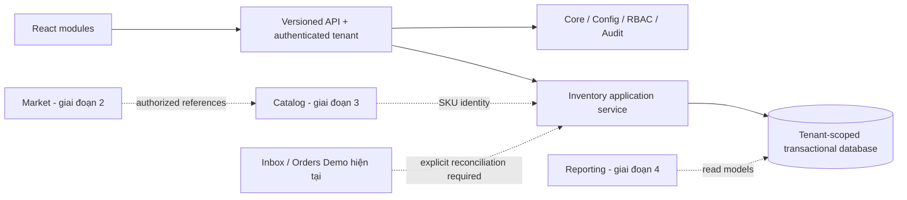

# Phân tích hệ thống và quyết định kiến trúc

Ngày khảo sát ban đầu: 17/11/2026; đối chiếu lại 18/11/2026. Phạm vi thực thi: Giai đoạn 1 và luồng kho → báo giá → PDF; các giai đoạn khác chỉ thiết kế.

## Hiện trạng đã xác minh

- React 19 + TypeScript strict, Vite 6, React Router 7; Vitest, Testing Library, ESLint.
- Inbox, CRM, chăm sóc, đơn hàng cũ, vận chuyển, dashboard đang hoạt động qua Demo adapter. HTTP adapter của các phân hệ này vẫn chỉ là client/hợp đồng. Kho có backend Node/SQLite riêng, authentication server, RBAC, tenant scope và migrations 001–006.
- `src/modules/operations/types.ts` có `Product.stock` nguyên không âm. Xác nhận đơn trừ stock; hủy/hoàn cộng lại. Đây là tồn khả dụng của Demo, không phải sổ tồn thực tế.
- `smartsales.operations.demo.v1` và Inbox là hai vùng localStorage khác nhau, không có giao dịch liên vùng hoặc đảm bảo nhiều người dùng.
- `/products` là giao diện danh mục SKU cơ bản nối API kho; chưa phải catalog sản phẩm độc lập. `/market-intelligence` có MVP dùng Gemini Google Search grounding và trả về phân tích tóm tắt, còn `/reports` vẫn là trang trạng thái. Market AI chỉ chạy khi cấu hình khóa ở máy chủ và chưa được nghiệm thu provider thật. Catalog Demo gồm sáu sản phẩm gốm/trang trí, không phải Lumi. Catalog báo giá kho đọc SKU thực tế, không fallback Demo.
- Kho đã có ledger, PO nhận từng phần, đơn bán giữ/xuất/trả trong transaction và UI sửa master/config. Chưa tự chuyển dữ liệu localStorage cũ sang kho. Không tìm thấy metadata Git trong workspace khảo sát.

## Thành phần tái sử dụng

Giữ các route, service port Demo/Live, components Modal, headers, CSS vận hành và i18n. Không thay ý nghĩa Product.stock hoặc tự biến dữ liệu localStorage thành dữ liệu sản xuất. Module kho mới có API, schema và giao diện riêng; SKU giữ `externalProductId` để nối catalog hiện tại sau một bước đối soát rõ ràng.

## Kiến trúc đích

Modular monolith trước: core (tenant, authentication, permission, config, audit, idempotency), inventory, catalog, market, reporting. Mỗi module sở hữu bảng và command; module khác chỉ tham chiếu ID và API/application service, không tự cập nhật balance.

Backend kho ban đầu dùng Node.js built-in SQLite, WAL và `BEGIN IMMEDIATE`, không dùng localStorage. Phù hợp một máy chủ có ổ đĩa bền vững; PostgreSQL + row locking là đích khi cần nhiều replica/khối lượng lớn. Không tuyên bố SQLite đơn máy chủ đã đáp ứng HA/mọi quy mô doanh nghiệp.

Tenant lấy từ access token đã xác thực, không lấy từ body/query/header tùy ý. Mọi query có tenant scope và foreign key ghép tenant. Token chỉ lưu hash phía server, có hạn và có thể thu hồi. Không đưa secret vào VITE_*.

## Configuration Engine

Core giữ version cấu hình theo tenant; chỉ nhận trường có schema, không thực thi code/SQL tùy ý. Business Configuration gồm module flags, kho, chính sách âm kho, ngưỡng, approval. Industry Template tạo bản sao cấu hình ban đầu, thay template không ghi đè dữ liệu. Custom Module phải đăng ký permission, migration và API riêng. Thay đổi cấu hình có audit, validation và version conflict.

## Ranh giới nghiệm thu

Không chuyển sang giai đoạn 2 khi Giai đoạn 1 chưa nghiệm thu. Backend kho mới không thay thế backend Inbox/Orders cũ chưa tồn tại. Đơn bán mới bên trong kho đã thực thi giữ → xuất → trả nguyên tử; `/orders` cũ vẫn dùng Demo/adapter riêng và chưa bridge. Báo giá đọc catalog kho và xuất PDF cục bộ, không giữ hàng hoặc tự tạo đơn. Chức năng chưa thực thi được đánh dấu trong INVENTORY_MODULE và IMPLEMENTATION_ROADMAP, không giả lập thành tích hợp thật.
