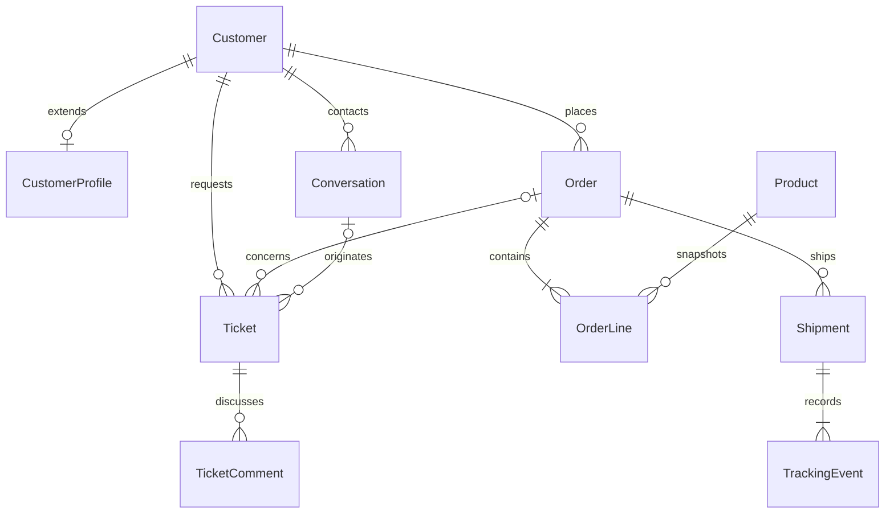

# Kiến trúc SmartSales Suite

## Phạm vi hiện tại

Ứng dụng React/TypeScript có Inbox và bốn module vận hành: CRM, Customer Care, Orders, Logistics. Đây là frontend có adapter Demo hoạt động và hợp đồng API để thay thế; chưa có backend Express/Firebase hoặc tích hợp hãng vận chuyển thực.

## Ranh giới mã nguồn

```text
src/
  components/                 Inbox hiện có
  types/inbox.ts              Kiểu liên hệ, nhân viên, hội thoại dùng chung
  services/inboxService.ts    Nguồn hồ sơ liên hệ và hội thoại
  modules/
    customers/               Danh sách và hồ sơ CRM 360°
    care/                    Ticket, phân công, SLA, ghi chú nội bộ
    orders/                  Tạo đơn, giá, trạng thái và thanh toán
    logistics/               Vận đơn và lịch sử theo dõi
    operations/
      types.ts               Hợp đồng dữ liệu và các lệnh service
      domain.ts              Sơ đồ chuyển trạng thái, hàm thuần
      service.ts             Điều phối lệnh Demo/API
      validation.ts          Kiểm tra dữ liệu runtime và liên kết
      carriers.ts            Metadata hãng vận chuyển mô phỏng
      data.ts                Seed cố định
      OperationsProvider.tsx Nạp snapshot và phản hồi mutation cho UI
      ui.tsx                 Thành phần giao diện dùng chung
      registry.ts            Đường dẫn và danh sách module
```

Component không ghi `localStorage` và không tự chỉnh tổng tiền/tồn kho. Service là điểm vào của nghiệp vụ. Các thao tác liên quan nhiều thực thể chạy trên một snapshot, kiểm tra toàn bộ bất biến rồi mới lưu một lần; hàng đợi ngăn mutation trong cùng instance ghi đè lẫn nhau.

## Quan hệ dữ liệu



`Customer` là hồ sơ liên hệ chuẩn dùng chung với Inbox. `CustomerProfile` chỉ mở rộng vòng đời, nguồn, người phụ trách, tag và ghi chú CRM; không sao chép tên/email. Đơn lưu bản chụp giá và thông tin người nhận để bảo toàn lịch sử. Mỗi đơn tối đa một vận đơn chưa hủy.

## Nghiệp vụ cốt lõi

- Đơn nháp chưa trừ kho. Xác nhận giữ kho; hủy đơn xác nhận/đóng gói trả kho đúng một lần. Đơn đã giao/hoàn không quay lại trạng thái nháp.
- Vận đơn chỉ tạo khi đóng gói. Lấy hàng chuyển đơn sang đang giao; giao thành công chuyển sang đã giao và ghi nhận COD trong Demo. Hoàn hàng trả kho, nhưng hoàn tiền là bước riêng có kiểm tra trạng thái.
- Số tiền VND dùng số nguyên an toàn; tổng được tính từ sản phẩm chuẩn, số lượng, giảm giá và phí giao hàng.
- Ticket phải tham chiếu đúng khách hàng của đơn/hội thoại. SLA ban đầu theo ưu tiên; giải quyết/đóng cần nội dung xử lý. Ghi chú không gửi khách hàng.
- Audit log Demo là lịch sử vận hành cục bộ, không phải chứng cứ bất biến phía máy chủ.

## Lưu trữ và nâng cấp

Inbox dùng `smartsales.inbox.demo.v1`, vận hành dùng `smartsales.operations.demo.v1` với `schemaVersion: 1`. Ngôn ngữ và bản nháp dùng khóa riêng. Dữ liệu lỗi được báo rõ, không âm thầm khôi phục. Khách hàng mới được bổ sung profile khi nạp dữ liệu vận hành.

Khôi phục vận hành chỉ đặt lại đơn/kho/vận đơn/ticket/profile mở rộng. Khôi phục Inbox thông thường chỉ đặt lại hội thoại mẫu và bản nháp, giữ hồ sơ liên hệ và vận hành. Khi Inbox lỗi dữ liệu, màn hình phục hồi cảnh báo rõ việc đặt lại cả hai tập dữ liệu. Hai lần ghi này không phải giao dịch nguyên tử; nếu bước sau lỗi, ứng dụng báo lỗi và cho thử khôi phục vận hành lại.

Khi đổi schema, thêm migration thuần `vN → vN+1`, test dữ liệu phiên bản cũ và giữ bản sao trước khi ghi. Không thay khóa để bỏ qua dữ liệu cũ. Khi cần tương thích module, giữ ID và các enum ổn định, thêm trường tùy chọn trước khi bắt buộc.

Demo không bảo đảm cập nhật đồng thời giữa nhiều tab/người dùng, giao dịch qua hai khóa lưu trữ hay đồng bộ thời gian thực. Backend tương lai cần transaction, version/ETag, idempotency key, index, phân trang và RBAC. Không di chuyển nguyên thiết kế `localStorage` thành cơ sở dữ liệu sản xuất.

## Thêm module hoặc adapter

1. Thêm thư mục UI riêng và route trong registry/App; không ghép nghiệp vụ vào component.
2. Mở rộng kiểu và lệnh service, validator và migration tương ứng.
3. Viết adapter Demo và API theo cùng interface. API lỗi phải báo lỗi, không rơi về Demo.
4. Test nghiệp vụ, liên kết và hành vi giao diện; cập nhật tài liệu hợp đồng API.
5. Chạy các bước CI trong [CONTRIBUTING](../CONTRIBUTING.md).
